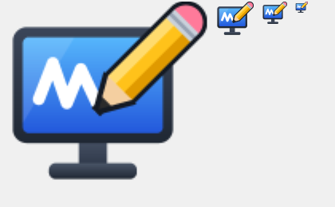

# RustShot

A tiny, fast screenshot and annotation tool for Windows, written in Rust.
It works like a minimal ShareX/Snagit: **select an area, draw on it, press a key**.



- About 1 MB single `.exe`, about 2 MB RAM idle, no runtime dependencies (pure Win32 + GDI+)
- Lives in the tray, starts with Windows if you want
- Every key is configurable in a YAML file

## User flow

1. **Start a capture**: press **PrintScreen** (or `Ctrl+Shift+PrintScreen`), left-click the
   tray icon, or pick **Make screen** in the tray menu.
2. **Select the area**. The screen freezes and dims.
   - *Hover and click* captures the highlighted **window** (over the desktop: the whole monitor).
   - *Drag* captures a **free rectangle**. A magnifier and a size label help with precision;
     arrow keys move the cursor 1 px (Shift: 10 px).
   - `Esc` or right click cancels. `Enter` takes the highlighted window.
3. **Draw** in the editor window:

   | Tool | Key | Notes |
   |------|-----|-------|
   | Move | `H` | click a shape to select it, drag to move; `Delete`/`Backspace` removes it; arrow keys nudge 1 px (Shift: 10 px) |
   | Arrow | `A` | Shift snaps to 45° |
   | Rectangle | `R` | Shift draws a square |
   | Text | `T` | click to place and type; `Enter`/`Esc` finishes, `Shift+Enter` adds a new line |
   | Edit text | | click a text with the Text tool, or double-click it with any tool; arrows/Home/End/Delete move and edit |
   | Free-hand pen | `P` | |
   | Colours | `1`…`9` | palette from the config |
   | Undo / Redo | `Ctrl+Z` / `Ctrl+Y` | |

   Toolbar: tools (move, arrow, rectangle, text, pen) · colours · size S/M/L · undo/redo · copy · save · close.
   Right click while dragging cancels the shape.
4. **Finish**:

   | Action | Default keys | Result |
   |--------|--------------|--------|
   | `SaveToClipboard` | `Esc`, `Enter`, `Ctrl+C` | image goes to the clipboard, window closes |
   | `SaveToDefaultLocation` | `Ctrl+S` | PNG saved to `DefaultLocation` (`c:\temp`), window closes |
   | `CloseWithoutSaving` | `F10` | window closes, nothing is saved |

## Tray menu

- **Make screen**: start a capture (also a left click on the icon)
- **Run at Windows startup**: checkbox (`HKCU\...\CurrentVersion\Run`)
- Open screenshots folder · Open settings (config.yml) · Reload settings · Exit

## Configuration

The file is `%APPDATA%\RustShot\config.yml`, created with defaults on first run.
For portable mode, put a `config.yml` next to `rustshot.exe`.
Changes apply automatically on the next capture.

```yaml
Hotkeys:
  MakeScreen: "PrintScreen;Ctrl+Shift+PrintScreen"
Keybindings:
  SaveToClipboard: "Esc;Enter;Ctrl+C"
  SaveToDefaultLocation: "Ctrl+S"
  CloseWithoutSaving: "F10"
  Undo: "Ctrl+Z"
  Redo: "Ctrl+Y;Ctrl+Shift+Z"
  ToolArrow: "A"
  ToolRectangle: "R"
  ToolText: "T"
  ToolPen: "P"
  ToolMove: "H"
  DeleteSelected: "Delete;Backspace"
DefaultLocation: "c:\\temp"
FileNamePattern: "Screenshot_{yyyy}-{MM}-{dd}_{HH}-{mm}-{ss}"   # + {fff} = ms
CloseAfterSave: true
CopyToClipboardOnSave: false
NotifyOnSave: true
NotifyOnCopy: false
Capture:
  DetectWindows: true
  ShowMagnifier: true
  DimOpacity: 0.45
  TrayDelayMs: 250
Drawing:
  DefaultTool: "Arrow"            # Arrow | Rectangle | Text | Pen | Move
  Palette: ["#FF3B30", "#FF9500", "#FFCC00", "#34C759", "#0A84FF", "#AF52DE", "#000000", "#FFFFFF"]
  DefaultColor: 0
  LineWidths: [2, 4, 8]           # S / M / L
  FontSizes: [16, 24, 36]
  DefaultSize: 1
  FontFamily: "Segoe UI"
  Shadow: true
  TextBackground: true           # contrasting box behind text (false = outline only)
```

**Key syntax**: `[Ctrl+][Alt+][Shift+][Win+]Key`. Put several alternatives in one string,
separated by `;`. Keys: `A`–`Z`, `0`–`9`, `F1`–`F24`, `Esc`, `Enter`, `Space`, `Tab`,
`Backspace`, `Delete`, `Insert`, `Home`, `End`, `PageUp`, `PageDown`, `Up/Down/Left/Right`,
`PrintScreen`, `Pause`, `Plus`, `Minus`, `Comma`, `Period`, `Numpad0`–`Numpad9`.
Invalid entries are reported in a tray notification.

## Build

Rust 1.82+. One of:

- **MSVC** (needs Visual Studio Build Tools with C++): `cargo build --release`
- **GNU** (no Visual Studio needed): `rustup toolchain install stable-x86_64-pc-windows-gnu`,
  then `cargo +stable-x86_64-pc-windows-gnu build --release`

`build.cmd` picks the right one automatically. The output is
`target\release\rustshot.exe`; copy it anywhere and run it.
The icon is generated in code (`src/icon_art.rs`) and embedded by `build.rs`
without `rc.exe`/`windres`. A copy is in `assets/rustshot.ico`.

Tests: `cargo test` (add `+stable-x86_64-pc-windows-gnu` for GNU).

## Code map

| File | Purpose |
|------|---------|
| `src/main.rs` | DPI awareness, single instance, GDI+ start-up |
| `src/app.rs` | hidden window, tray events, hotkeys and keyboard hook, capture pipeline, config reload |
| `src/tray.rs` | tray icon, menu, notifications, Run-at-startup registry |
| `src/capture.rs` | full virtual-screen grab, window/monitor rectangles |
| `src/selector.rs` | full-screen selection overlay (window pick / drag, magnifier) |
| `src/editor.rs` | drawing window: toolbar, tools, undo, rendering, actions |
| `src/gfx.rs` | DIB memory bitmaps + GDI+ wrapper (anti-aliased drawing) |
| `src/output.rs` | clipboard (DIB + PNG), PNG encoding, file naming |
| `src/config.rs` | YAML schema, defaults, file location |
| `src/keys.rs` | key-combo parsing/matching |
| `src/icon_art.rs`, `build.rs` | procedural icon, `.res` / COFF resource generation |

Requirements and backlog: [REQUIREMENTS.md](REQUIREMENTS.md).
